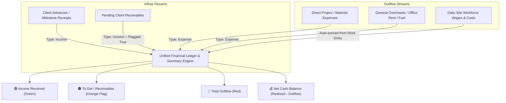
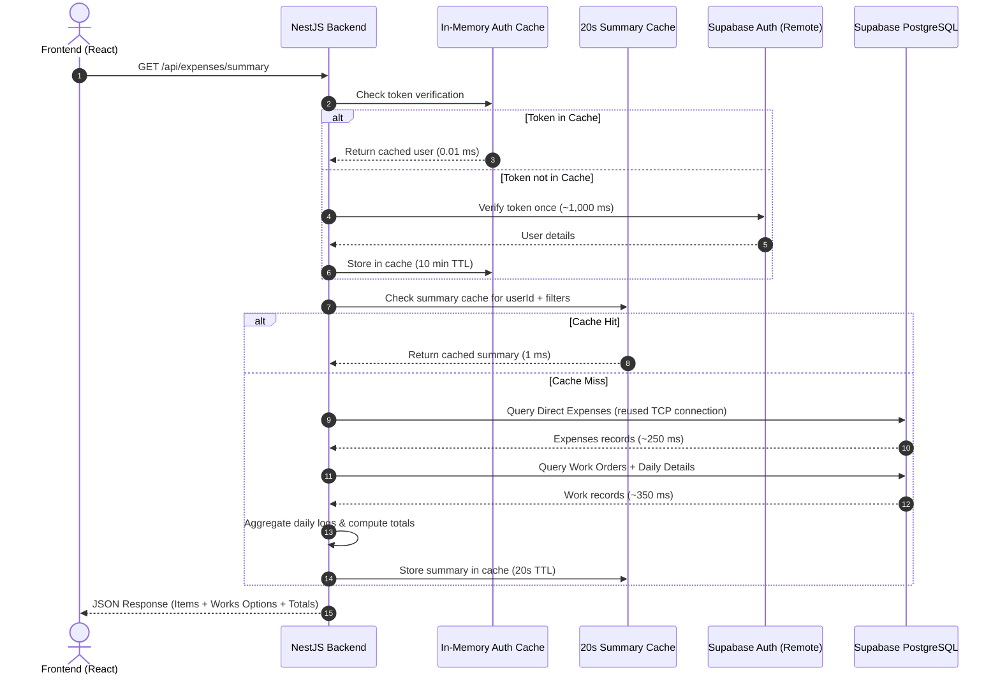

# ⚡ VoltCRM - Expense & Cash Flow Tracker Documentation

A complete architectural and functional guide to the **Expense & Cash Flow Tracker** in VoltCRM, built specifically for electrical contractors, substation engineers, and industrial cabling businesses.

---

## 📌 1. Overview & Core Philosophy

In electrical contracting, managing cash flow is challenging because finances are split between:
1. **Direct financial movements** (Client milestone advances, material bills, vehicle fuel, GST payouts, supplier invoices).
2. **On-site execution expenses** (Daily labor wages for permanent wiremen and casual workers, daily site refreshments, hardware purchases).
3. **Pending receivables** (Invoiced milestone claims submitted to clients that are yet to be received).

The **VoltCRM Expense Tracker** unifies all these streams into a **single consolidated financial ledger** with real-time project attribution, instant filtering, and sub-second performance.



---

## 🎨 2. The 3-Color Financial Model

The system employs a standardized 3-color status indicator across the UI, cards, and print reports:

| Color Code | State | Description | Balance Impact |
| :--- | :--- | :--- | :--- |
| 🟢 **Green** | **+ Income (Cash In)** | Realized cash received in bank, UPI, or cash (e.g., client advance, milestone settlement). | **Adds** to Net Cash Balance |
| 🟠 **Orange Flag** | **To Get (Receivables)** | Verified milestone or claim that the client owes but has **not yet paid**. Flagged with an orange tag. | Tracked separately; does **not** inflate liquid cash |
| 🔴 **Red** | **- Output (Cash Out)** | Real cash spent on labor wages, materials, logistics, tools, or general operations. | **Subtracts** from Net Cash Balance |

---

## 🔄 3. Unified Integration: Direct Expenses + Daily Work Logs

A key innovation of VoltCRM is the **automatic zero-duplicate sync** between job site logs and the financial tracker:

### A. Direct Transactions (Manual)
- Created via the **"+ Record Transaction"** button.
- Used for project disbursements, vendor invoices, client advances, equipment rentals, and overheads.
- Can be linked to a specific **Work Order** (`WRK-2610-XXX`) or marked as **General Overhead** (Unassigned).

### B. Automated Daily Work Logs (Site Execution)
- Whenever a site supervisor logs daily work progress under **Work Entry** (`WorkDetailPage` or `DailyWorkDetailModal`):
  - Permanent electrician wages (calculated from hourly rates $\times$ hours worked).
  - Casual / temporary workforce wages.
  - Miscellaneous daily site expenses (conveyance, drill bits, hardware, tea/refreshments).
- These logs are **automatically aggregated and presented inside the Expense Tracker**:
  - Labeled with a distinct `Daily Log` badge and a `🕒` clock icon.
  - Category displayed as `Daily Wages & Site Expenses` or `Daily Labour Wages`.
  - Party displayed as `X Workers` (or `Daily Workforce`).
  - Linked directly to the relevant Work Order code and project title.
- **Benefit**: Contractors never have to enter wage expenses twice.

---

## 📊 4. Financial Summary Metrics

At the top of the Expense Tracker, 4 live metric cards calculate totals dynamically based on the active filters:

1. **Net Cash Balance**  
   $$\text{Net Cash Balance} = \sum \text{Income Received (Green)} - \sum \text{Total Outflow (Red)}$$  
   Represents actual in-hand liquid liquidity. Displayed in emerald green (positive) or rose red (negative).

2. **Income Received**  
   $$\sum \text{Income where } \text{isFlagged} = \text{false}$$  
   Total confirmed cash inflows received into the business.

3. **To Get (Receivables)**  
   $$\sum \text{Income where } \text{isFlagged} = \text{true}$$  
   Total outstanding client payments awaiting collection. Tagged with an orange flag badge.

4. **Total Outflow**  
   $$\sum \text{Direct Expenses} + \sum \text{Daily Site Wages \& Costs}$$  
   Total money expended across all electrical projects and general overheads.

---

## 🛠️ 5. Key Features & Functionality

### 1. Minimal Transaction Modal
- **Quick Flow Toggle**: Switch between `+ Income (Cash In)` and `- Output (Expense)` with one click.
- **"To Get" Checkbox**: For Income, checking `[✓] To Get (Pending from client)` flags the entry with the Orange Badge.
- **Clean 2-Column Layout**: Structured date, amount, work order selector, payer/payee, payment mode, and category fields.
- **No Clutter**: Distracting icons and repetitive helper banners have been eliminated.

### 2. Work Order Association
- Any entry can be assigned to an active electrical project from a dropdown showing `Work Code • Work Name (Site Name)`.
- If an entry is for general office expenses, tools, or administrative costs, selecting **"General Overhead (No Work Order)"** keeps it unassigned.

### 3. Dynamic Modes & Categories (+ Custom Extensibility)
- **Standard Payment Modes**: Cash, UPI / GPay / PhonePe, NEFT / RTGS, Cheque, Company Bank Transfer.
- **Standard Income Categories**: Client Advance, Milestone Payment, Final Settlement, Retention Release, Scrap / Material Salvage, Other Receipt.
- **Standard Expense Categories**: Materials & Consumables, Tools & Equipment, Transport & Logistics, Site Food & Welfare, Fuel & Travel, Office & Administrative, Subcontractor Payout, GST & Taxes, Miscellaneous.
- **On-the-Fly Custom Creation**: Users can click `+ Custom` directly inside the modal dropdowns to save custom payment modes or categories without leaving the page.

### 4. Advanced Search, Filtering & Multi-Column Sorting
- **Real-Time Search**: Matches across category, remarks, work code, project name, party/person name, payment mode, and numerical amounts.
- **Flow Filter**:
  - *All Flow Types*
  - *🟢 Income Received Only*
  - *🟠 To Get (Receivables) Only*
  - *🔴 Output / Expenses Only*
  - *🕒 Daily Work Logs Only*
- **Work Order Filter**: Filter transactions by any specific project.
- **Payment Mode Filter**: Filter by Cash, UPI, Bank Transfer, etc.
- **Date Range Range**: Filter between Start Date and End Date.
- **Sorting Options**:
  - Date (Newest first / Oldest first)
  - Work Code (A–Z / Z–A)
  - Work Name (A–Z)
  - Amount (Highest first / Lowest first)

### 5. Printable Financial Statement & PDF Export
- Clicking **"Print Statement"** opens an executive A4-optimized ledger ready for print or browser PDF save.
- **Header**: Official contractor letterhead with company branding, tax registration, contact info, and generation timestamp.
- **Executive Summary Box**: Real-time summary figures for Total Inflow, Pending Receivables, Total Outflow, and Net Cash Position.
- **Tabular Ledger**: Clean printable table containing Date, Work Order, Flow Type, Description, Party, Mode, and Amount.
- **Print Optimization**: Automatically hides sidebars, navigation headers, action buttons, and pagination controls via `@media print` rules.

---

## 🗄️ 6. Data Model & Architecture

### Database Schema (Prisma ORM)

```prisma
model Expense {
  id          String    @id @default(uuid())
  userId      String    // Scoped strictly to the authenticated contractor
  date        DateTime
  amount      Float     @default(0)
  category    String    // e.g. "Materials & Consumables", "Client Advance"
  type        String    // "income" or "expense"
  remarks     String?   // Invoice number, notes, description
  workId      String?   // Optional foreign key / relation to Work
  workCode    String?   // Cached work code (e.g. "WRK-2610-996")
  workName    String?   // Cached work name (e.g. "Light fitting")
  personName  String?   // Payer ("Who given cash") or Payee ("Paid to")
  paymentMode String?   // "Cash", "UPI", "Bank Transfer", etc.
  isFlagged   Boolean?  @default(false) // TRUE = Orange Flag ("To Get" receivable)
  createdAt   DateTime  @default(now())
  updatedAt   DateTime  @updatedAt

  @@index([userId])
  @@index([type])
  @@index([date])
  @@index([workId])
  @@index([workCode])
}
```

### Daily Work Log Schema (Embedded inside `Work.dailyDetails`)

```typescript
interface DailyWorkDetail {
  id: string;
  date: string;
  workDone: string;
  labourCount: number;
  labourDetails: string;
  labourMembers: DailyLabourMember[];      // Hourly rates, hours worked, wages
  additionalMembersCount: number;
  totalDailyWage: number;                  // Sum of all worker wages
  otherExpenses?: DailyOtherExpense[];     // On-site miscellaneous expenses
  totalOtherExpenses?: number;             // Sum of other site expenses
  totalDailyCost: number;                  // totalDailyWage + totalOtherExpenses
  remarks?: string;
  createdAt?: string;
}
```

---

## ⚡ 7. Performance & Optimization Architecture

The Expense Tracker is optimized for sub-second speeds even over high-latency connections to Supabase:



### Core Performance Pillars:
1. **Consolidated API Endpoint (`GET /api/expenses/summary`)**:
   - Instead of 3 round-trips for expenses, daily logs, and work dropdown options, the frontend makes **1 single network request**.
2. **In-Memory JWT Auth Cache**:
   - Eliminates the ~1,070ms HTTPS verification round-trip on every call by caching validated sessions in memory.
3. **Sequential Pooled Queries**:
   - Reuses a single warm PostgreSQL connection (`connection_limit=5&pool_timeout=15`), avoiding secondary TLS connection handshakes.
4. **20-Second Fast Query Cache with Auto-Invalidation**:
   - Switching tabs or re-rendering completes in **< 5ms**.
   - Cache automatically purges immediately whenever a user creates, edits, or deletes an expense, or saves a daily work entry.

---

## 📖 8. Step-by-Step User Workflows

### Scenario A: Recording a Client Milestone Advance
1. Open **Expense Tracker** from the sidebar.
2. Click **"+ Record Transaction"**.
3. Select **"+ Income (Cash In)"** (it turns Green).
4. Enter the **Date** and **Amount** (e.g., `₹50,000`).
5. Select the **Work Order** from the dropdown (e.g., `WRK-2610-996 • Light fitting`).
6. Enter **Who Given Cash** (e.g., `Apex Builders / Mr. Sharma`).
7. Choose the **Mode of Transaction** (e.g., `NEFT / RTGS` or `UPI`).
8. Select Category `Client Advance`.
9. Click **"Save Transaction"**.  
   *Result*: Green card and table row created; Net Cash Balance increases by ₹50,000.

---

### Scenario B: Flagging a Bill as "To Get" (Receivable)
1. Click **"+ Record Transaction"**.
2. Select **"+ Income (Cash In)"**.
3. Check **"[✓] To Get (Pending from client / Yet to receive)"**.
4. Enter the amount (e.g., `₹25,000`).
5. Link it to the relevant Work Order.
6. Enter remarks (e.g., `Submitted 2nd Floor Conduit Raft Inspection Invoice`).
7. Click **"Save Transaction"**.  
   *Result*: Row is highlighted with an **Orange Tag** and **Flag Icon**. Total "To Get" metric increments by ₹25,000 without artificially inflating liquid balance.

---

### Scenario C: Logging On-Site Daily Labor & Other Site Expenses
1. Go to **Work Entry** (`/works`).
2. Click the green **"Calendar / X Day(s) Logged"** button on any job card.
3. Select permanent electricians from the top swipe-chips (e.g., `+ Hussain`) and adjust their hours (e.g., `8 hrs @ ₹200/hr = ₹1,600`).
4. (Optional) Add other site expenses (e.g., `PVC tape & hacksaw blades - ₹450`).
5. Save the daily log.
6. Switch to **Expense Tracker**.  
   *Result*: Automatically shows a new row: `- ₹2,050 Output` tagged with `Daily Log` and `WRK-2610-XXX`.

---

## 📂 9. Source Code Map

| Functionality | Relevant File Path |
| :--- | :--- |
| **Frontend Page View** | [`frontend/src/pages/ExpensePage.tsx`](file:///d:/freelance/elecrm/frontend/src/pages/ExpensePage.tsx) |
| **Transaction Modal** | [`frontend/src/components/expense/ExpenseModal.tsx`](file:///d:/freelance/elecrm/frontend/src/components/expense/ExpenseModal.tsx) |
| **Print Statement Component** | [`frontend/src/components/expense/ExpensePrintView.tsx`](file:///d:/freelance/elecrm/frontend/src/components/expense/ExpensePrintView.tsx) |
| **Categories & Modes Config** | [`frontend/src/lib/expenseConfig.ts`](file:///d:/freelance/elecrm/frontend/src/lib/expenseConfig.ts) |
| **Backend API Controller** | [`backend/src/expense/expense.controller.ts`](file:///d:/freelance/elecrm/backend/src/expense/expense.controller.ts) |
| **Backend Aggregation Service** | [`backend/src/expense/expense.service.ts`](file:///d:/freelance/elecrm/backend/src/expense/expense.service.ts) |
| **Auth Caching Guard** | [`backend/src/auth/supabase.service.ts`](file:///d:/freelance/elecrm/backend/src/auth/supabase.service.ts) |
| **Daily Work Log Modal** | [`frontend/src/components/work/DailyWorkDetailModal.tsx`](file:///d:/freelance/elecrm/frontend/src/components/work/DailyWorkDetailModal.tsx) |

